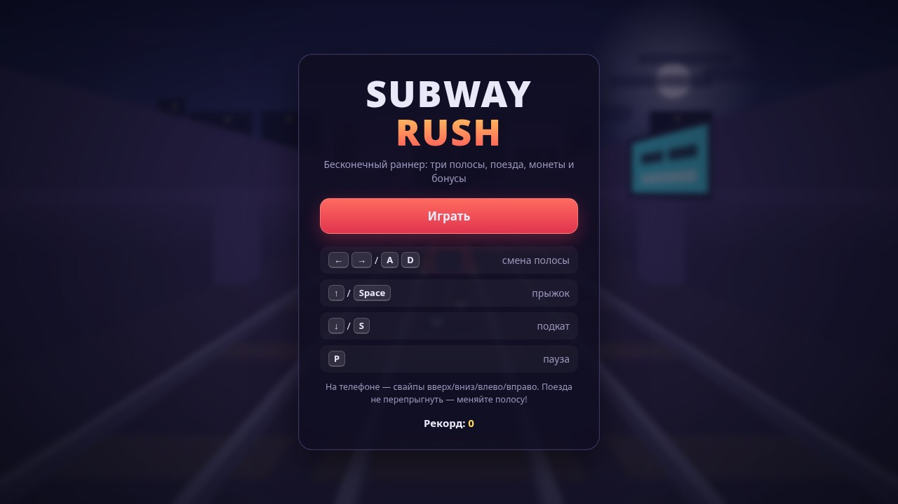
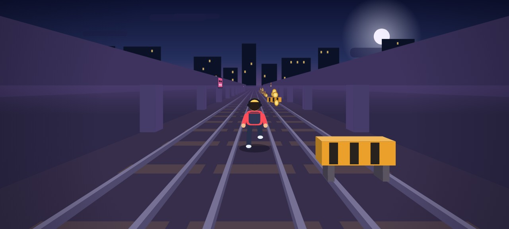
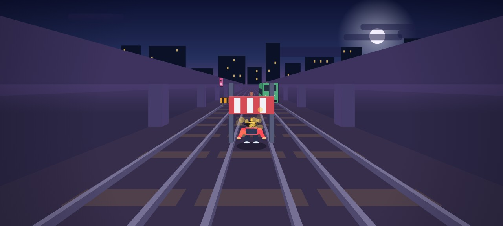

# Subway Rush

[](https://github.com/Valeogamer/RunnerGame/actions/workflows/tests.yml)
[](https://github.com/Valeogamer/RunnerGame/actions/workflows/pages.yml)
[](LICENSE)

Бесконечный 2D-раннер в духе Subway Surfers: три полосы, псевдо-3D перспектива,
поезда, барьеры, ворота, монеты, бонусы и растущая скорость.

Написано на чистом JavaScript + Canvas 2D. Без сборки, зависимостей, ассетов и
звуковых файлов — всё рисуется кодом, звуки синтезируются через WebAudio.

## 🎮 Играть

- **Онлайн:** https://valeogamer.github.io/RunnerGame/ (публикуется workflow `deploy-pages`)
- **Локально:** откройте `index.html` в браузере — работает и с `file://`

Или через локальный сервер:

```bash
python3 -m http.server 8000   # или: npm start
# затем http://localhost:8000
```

## Скриншоты

| Меню | Заезд |
|------|-------|
|  |  |

| Подкат под ворота | Высокая скорость |
|-------------------|------------------|
|  |  |

## Управление

| Действие     | Клавиатура                     | Телефон             |
|--------------|--------------------------------|---------------------|
| Смена полосы | `←` / `→` или `A` / `D`        | свайп влево/вправо  |
| Прыжок       | `↑` / `W` / `Space`            | свайп вверх / тап   |
| Подкат       | `↓` / `S`                      | свайп вниз          |
| Пауза        | `P` / `Esc`                    | кнопка ⏸            |
| Звук         | `M`                            | кнопка 🔊           |
| Заново       | `R` / `Enter` на экране финала | кнопки              |

В воздухе `↓` — быстрое падение с авто-подкатом при приземлении.

## Правила

- **Поезд** (цветной вагон) — не перепрыгнуть, только сменить полосу.
- **Барьер** (оранжевый с чёрными полосами) — перепрыгнуть.
- **Ворота** (красно-белые на стойках) — проехать подкатом.
- **Монеты** — 10 очков (×2 при активном бонусе).
- **Бонусы:** 🧲 магнит (притягивает монеты), 🛡️ щит (поглощает один удар),
  ×2 (двойные очки).
- Скорость растёт от 11 до 28 м/с за ~2.2 км. Генератор всегда оставляет
  минимум одну свободную полосу — заезды на 100% проходимы.
- Рекорд и настройка звука хранятся в `localStorage`.

## Структура

```
index.html               разметка, HUD и оверлеи (меню, пауза, финал)
css/style.css            интерфейс, панели, кнопки
js/config.js             все константы баланса (скорость, прыжок, спавн…)
js/utils.js              математика, случайности, localStorage
js/audio.js              синтез звуков на WebAudio (без файлов)
js/entities.js           игрок и фабрики объектов
js/game.js               логика: состояния, спавн, столкновения, эффекты
js/render.js             псевдо-3D проекция, фон, трек, декорации
js/render-entities.js    отрисовка объектов, игрока, частиц, оверлеев
js/input.js              клавиатура и свайпы
js/main.js               цикл игры, HUD, кнопки, переходы состояний
test/smoke.js            смоук-тесты логики (Node, без DOM)
docs/screenshots/        скриншоты для README
```

## Тесты

```bash
node test/smoke.js   # или: npm test
```

Что проверяется:

1. Честность генерации: поезда никогда не занимают все 3 полосы на одной
   глубине, барьеры/ворота не пересекаются с поездами, монеты не спавнятся
   внутри поездов.
2. Столкновение с поездом → game over, рекорд сохраняется в `localStorage`.
3. Барьер без прыжка = крах, с прыжком — проход; ворота без подката = крах,
   с подкатом — проход.
4. Монеты собираются, магнит притягивает из соседней полосы, ×2 удваивает
   очки, щит поглощает удар и уничтожает препятствие.
5. Прогон 180 секунд ботом-игроком: стабильность, рост скорости, очки.

Эти же тесты гоняются в CI (`.github/workflows/tests.yml`) на каждый push.

## Настройка баланса

Почти всё живёт в `js/config.js`: скорость (`SPEED_MIN` / `SPEED_MAX`),
интервалы спавна (`GAP_TIME_MIN` / `GAP_TIME_MAX`), прыжок (`JUMP_V`,
`GRAVITY`), длительность подката, радиус магнита и т.д.

В консоли браузера доступен отладочный объект `RG.instance`
(`{ game, renderer, audio }`) — например, `RG.instance.game.score = 99999`.

## Репозиторий на GitHub

- Ветка по умолчанию — `main`.
- **CI** (`.github/workflows/tests.yml`): `node --check` для всех скриптов +
  `node test/smoke.js` на push и pull request.
- **Pages** (`.github/workflows/pages.yml`): публикует статику игры на
  https://valeogamer.github.io/RunnerGame/ при push в `main`
  (нужен источник Pages = «GitHub Actions» в Settings → Pages).
- В настройках репозитория стоит указать: **Description** —
  «Бесконечный 2D-раннер в духе Subway Surfers на чистом Canvas 2D»,
  **Topics** — `game`, `canvas`, `javascript`, `html5-game`, `endless-runner`,
  `runner-game`, `subway-surfers-like`, `no-dependencies`.
- Лицензия — MIT (`LICENSE`).

## Лицензия

[MIT](LICENSE) © 2026 Valeogamer
